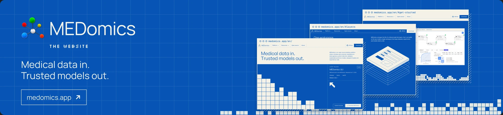
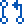

<!--suppress HtmlDeprecatedAttribute -->
<!-- Banner source: Figma file "MEDomicsLab Website", frame "MEDomics Website — Concept B · Blueprint" (exported at 2048px, WebP). -->
<p align="center">
  <a href="https://medomics.app/">
    
  </a>
</p>

<p align="center"><strong>The official website of MEDomics, the open-source platform for medical machine learning, from heterogeneous patient data to validated, explainable models.</strong></p>

> [!IMPORTANT]
> **Design credit:** the design of this website is recreated from [nualt.fr](https://nualt.fr/). Its layout, colour palette, components and motion patterns were rebuilt for MEDomics; the text, illustrations, icons and code are our own. Details in [Design credit](#design-credit).

<p align="center">
  
  
  
  
  <a href="https://github.com/MEDomicsLab/MEDomics-website/actions/workflows/ci.yml"></a>
  <a href="#license"></a>
</p>

<p align="center">
  &nbsp;<a href="https://medomics.app/">Live website</a>
  &nbsp;&nbsp;·&nbsp;&nbsp;
  &nbsp;<a href=".github/CONTRIBUTING.md">Contribute</a>
  &nbsp;&nbsp;·&nbsp;&nbsp;
  &nbsp;<a href="#running-the-site-locally">Run locally</a>
  &nbsp;&nbsp;·&nbsp;&nbsp;
  &nbsp;<a href="https://medomicslab.gitbook.io/medomics-docs">MEDomics docs</a>
</p>

> [!NOTE]
> This repository holds the **website** only. To report a bug in the MEDomics application itself, open an issue in [MEDomicsLab/MEDomics](https://github.com/MEDomicsLab/MEDomics/issues). MEDomics is developed and maintained by [MEDomicsLab](https://www.medomicslab.com/).

## <a id="contributing"></a> Contributing

> [!TIP]
> `main` is protected: every change goes through a pull request with a [Conventional Commit](https://www.conventionalcommits.org/) title, one approving review from a maintainer, and green checks. The full workflow is in [**CONTRIBUTING.md**](.github/CONTRIBUTING.md).

<details>
<summary><strong>&nbsp;&nbsp;The short version</strong></summary>

<br>

1. Branch from `main`: `feat/<topic>`, `fix/<topic>`, `docs/<topic>`, `chore/<topic>`…
2. Make the change, then run `npm run check` (and `npm run build && npm run test:e2e` if you touched a page).
3. Open a pull request titled like `feat(download): add checksums to the installer cells`. Fill in the template.
4. Wait for green checks and a review. The PR is **squash-merged**, so its title becomes the commit on `main`, and Vercel deploys it.

</details>

<details>
<summary><strong>&nbsp;&nbsp;Where content lives (edit copy without touching components)</strong></summary>

<br>

| What                                  | File                                                                    | Notes                                                                                                                          |
| ------------------------------------- | ----------------------------------------------------------------------- | ------------------------------------------------------------------------------------------------------------------------------ |
| Every string a page shows             | [`src/content/en/index.ts`](src/content/en/index.ts)                    | Typed (`Dict`), so a missing or misspelt key fails `npm run typecheck`. `{version}` and `{date}` are filled from the releases  |
| Every outbound URL                    | [`src/content/links.ts`](src/content/links.ts)                          | One line per link: the docs domain, GitHub, Discord, YouTube, MEDomicsLab…                                                     |
| Releases (version, dates, installers) | [`src/content/releases.json`](src/content/releases.json)                | **Generated** by `npm run build` from the public GitHub Releases API. Never edit by hand. Validated by `npm run lint:releases` |
| Screenshots                           | [`src/content/images.json`](src/content/images.json) + `public/images/` | **Generated** by `npm run images` from the original captures (AVIF + WebP, title bars cropped, personal paths masked)          |
| Particle-fan labels                   | [`src/content/fans.ts`](src/content/fans.ts)                            | Only shipped inputs are solid; disabled modules appear as faint "ghosts"                                                       |

To add a page: create `src/app/[locale]/<page>/page.tsx` (copy an existing one for `generateMetadata`), add its copy to `src/content/en/index.ts`, add it to `src/app/sitemap.ts`, and add it to `ROUTES` in `e2e/helpers.ts` so smoke, SEO, accessibility and layout tests cover it.

</details>

<details>
<summary><strong>&nbsp;&nbsp;Adding French (Release 2)</strong></summary>

<br>

1. Create `src/content/fr/index.ts` exporting `fr` typed as `Dict` (`src/content/types.ts`).
2. Register it in `src/lib/i18n.ts`: add `'fr'` to `locales` and `fr` to `dicts`.
3. Add the `fr` alternates in `src/lib/site.ts`, a language toggle in the header, and replace the `/` → `/en/` redirect in `vercel.json` with a language pick.

</details>

## <a id="running-the-site-locally"></a> Running the Site Locally

```bash
git clone https://github.com/MEDomicsLab/MEDomics-website.git
cd MEDomics-website
node --version            # Node 24 (see .nvmrc); Next.js 16 needs ≥ 20.9
npm ci
npm run dev               # http://localhost:3000/en/
npm run build             # fetch releases → static export in out/
npm run serve             # serve out/ like Vercel does: http://localhost:4173/
```

On Windows Git Bash, prefix route arguments with `MSYS_NO_PATHCONV=1` so `/en/` is not rewritten into a Windows path.

<details>
<summary><strong>&nbsp;&nbsp;Quality gates</strong></summary>

<br>

```bash
npm run check        # typecheck, ESLint (0 warnings), Prettier, markdownlint, knip, unused assets,
                     # production licences, releases.json schema, unit tests of the scripts
npm run check:links  # after a build: every internal href/src/#fragment and sitemap URL resolves
npm run size         # after a build: JS ≤ 300 KB and CSS ≤ 15 KB (brotli)
npm run check:full   # all of the above + build + the Playwright suite
npm run lhci         # Lighthouse CI on the build (accessibility, best practices, SEO ≥ 0.95)
```

Every one of these runs in CI on each pull request (see [Continuous integration](#continuous-integration)).

</details>

<details>
<summary><strong>&nbsp;&nbsp;Tests</strong></summary>

<br>

```bash
npm run test:e2e:install  # once: the Chromium build Playwright needs
npm run test:scripts      # node:test unit tests of scripts/lib (releases parsing, link resolution)
npm run test:e2e          # the full Playwright suite against the production build (run `npm run build` first)
npm run test:a11y         # axe-core only (WCAG 2.2 A/AA, colour contrast included)
npm run test:seo          # metadata, canonical/hreflang, JSON-LD, sitemap, robots, no-JS rendering
```

| Spec         | What it guarantees                                                                                                                                                                                                |
| ------------ | ----------------------------------------------------------------------------------------------------------------------------------------------------------------------------------------------------------------- |
| `smoke`      | Every page returns 200 with no console errors or failed requests; `/` → `/en/`; trailing-slash redirects; branded `noindex` 404                                                                                   |
| `seo`        | One unique title and description per page, canonical + hreflang, reachable OG image, JSON-LD version = latest release, sitemap = exactly the pages, readable without JavaScript                                   |
| `a11y`       | No serious or critical axe violation on any page, desktop and phone                                                                                                                                               |
| `navigation` | Mega-menu, Escape and focus return, header palette over blue sections, skip link, phone sheet, new pages open at the top                                                                                          |
| `home`       | The pinned hero steps through the four layers **and reverses**, layer headings jump back, the pipeline scene plays, finishes and rewinds, tree pixels and particle fans move, reduced-motion fallbacks are static |
| `download`   | Installer links match the latest release, the version picker swaps them, the release card names the version                                                                                                       |
| `layout`     | No horizontal overflow from 320 to 1905 px with motion on and off; buttons ≥ 44 px tall on phones                                                                                                                 |

Tests run against the static export served by [`scripts/serve.mjs`](scripts/serve.mjs), which applies `vercel.json` (redirects, trailing slashes, 404), so they test what Vercel serves.

</details>

<details>
<summary><strong>&nbsp;&nbsp;Other scripts</strong></summary>

<br>

```bash
npm run images                        # re-process the original captures into public/images (needs ../media)
node scripts/make-og.mjs              # re-render public/og/og-default.png
node scripts/make-cursors.mjs         # re-render public/cursors/*.svg
node scripts/make-readme-icons.mjs    # re-render docs/assets/icons/*.svg from the pixel bitmaps
npm run capture -- /en/ captures      # scroll-step screenshots, desktop + phone
```

</details>

## <a id="continuous-integration"></a> Continuous Integration

| Workflow                                                         | Runs on                          | Jobs                                                                                                                                                             |
| ---------------------------------------------------------------- | -------------------------------- | ---------------------------------------------------------------------------------------------------------------------------------------------------------------- |
| [`ci.yml`](.github/workflows/ci.yml)                             | every PR and push to `main`      | **Lint & static checks** · **Build (production)** (+ links, size budget) · **Playwright e2e** · **Accessibility (axe)** · **Lighthouse CI** · **Lint workflows** |
| [`pr-quality.yml`](.github/workflows/pr-quality.yml)             | every PR                         | **Conventional PR title** · Bundle size diff (comment)                                                                                                           |
| [`security.yml`](.github/workflows/security.yml)                 | every PR, push to `main`, weekly | **npm audit (production deps)** · **Secret scanning (gitleaks)** · OSV scan (report only)                                                                        |
| [`refresh-releases.yml`](.github/workflows/refresh-releases.yml) | weekly, or by hand               | Rebuilds production so a new MEDomics release reaches the site                                                                                                   |
| [Dependabot](.github/dependabot.yml)                             | weekly                           | Grouped npm and GitHub Actions updates, with Conventional titles                                                                                                 |

Jobs in **bold** are required status checks on `main` ([ruleset](.github/rulesets/protect-main.json)). The Playwright jobs run in the official Playwright container whose version is read from `package.json`, so the browsers always match the test runner.

## <a id="deployment"></a> Deployment

The site is a static export (`next build` with `output: 'export'`) hosted on **Vercel**, configured by [`vercel.json`](vercel.json): `npm ci`, `npm run build`, output `out/`, trailing slashes, the `/` → `/en/` redirect, security headers and long-term caching for hashed assets.

- Every push to `main` deploys to production; every pull request gets a preview URL from Vercel.
- The build fetches the latest MEDomics releases. With the `VERCEL_DEPLOY_HOOK_URL` secret set, a weekly workflow redeploys so new releases appear without a commit.
- One-time repository and Vercel setup is listed in [`docs/repository-setup.md`](docs/repository-setup.md).

<details>
<summary><strong>&nbsp;&nbsp;Project structure</strong></summary>

<br>

```text
src/app/[locale]/        root layout (per-locale <html lang>), page template, pages
src/app/global-not-found.tsx   branded 404 (exported as out/404.html)
src/app/(redirect)/      "/" fallback page (Vercel redirects "/" before it is reached)
src/components/
  layout/      Header (cells, mega-menus, nav swap, phone sheet), Footer, Preloader, Section, UpdateToast
  motion/      SmoothScroll (Lenis), RollingText, Reveals, DrawBox, Masks, TreePulses
  canvas/      FallingBlocks (hero board), ParticleFans (workflow)
  illustrations/  iso/ (isometric kit), pixel/ (bitmap icons), LogoMark, GitHubMark, PixelBoardStrip…
  sections/    home/ (HeroLayers, Workflow, Proof, ResourcesBento, OpenSource, Faq, FinalCta, PipelineScene), download/, platform/, LegalPage
  ui/          Button (+ PixelFill), SmartLink, Shot (picture) + WindowFrame
src/content/   en/ (all copy), links.ts, releases.json (+ _schemas/), images.json, fans.ts
src/lib/       i18n, site (SEO), releases, iso projection, seeded RNG, motion gates, dissolve, lenis, gsap (lazy)
scripts/       build helpers, check/ (custom quality gates), lib/ (+ __tests__/), serve.mjs
e2e/           Playwright specs
docs/          README assets, repository setup
```

</details>

<details>
<summary><strong>&nbsp;&nbsp;Notes on the Next.js 16 static export</strong></summary>

<br>

- `scripts/postexport.mjs` writes flattened copies of the segment-prefetch files (`__next.$d$locale.about.__PAGE__.txt`), because static hosts cannot rewrite them. Without them, client-side prefetches return 404.
- The 404 page uses `experimental.globalNotFound`, because the root layout sits under `[locale]`.
- `template.tsx` fades pages in with **opacity only**: a transform there would break the `position: fixed` pin of the hero.

</details>

<details>
<summary><strong>&nbsp;&nbsp;Pending decisions and content</strong></summary>

<br>

- The canonical docs domain (`medomicslab.gitbook.io` vs `medomics-udes.gitbook.io`).
- Approval of the flat SVG logo rendition (`src/components/illustrations/LogoMark.tsx`), or an official vector.
- The Privacy and Terms pages are **draft text** until the team's own texts are provided.
- Partner logos for the About page (files and permission).
- Missing screenshots: Evaluation/SHAP dashboard, MEDfl canvas, Application form, Superset.
- Release 2: `/proofs-of-concept`, `/resources`, French.

</details>

## <a id="design-credit"></a> Design Credit

The design of this website is **recreated from [nualt.fr](https://nualt.fr/)**. We studied that site closely (its CSS values, layout and behaviour, captured in screenshots) and rebuilt its design language for MEDomics.

| From nualt.fr                                                                                                                                    | Our own                                                                                              |
| ------------------------------------------------------------------------------------------------------------------------------------------------ | ---------------------------------------------------------------------------------------------------- |
| The two-colour palette, with the same cobalt blue (`#0755B5`) and ivory (`#F4F2E8`) values                                                       | All text and the MEDomics content, screenshots and logo                                              |
| The blueprint grid of hairlines, the page structure and the order of the home page sections                                                      | Every illustration, icon, pixel cursor and animation drawing, generated from scratch in code         |
| The header that changes colour over blue sections, the mega-menus and the split section headers                                                  | All of the source code, written for this site (no file from nualt.fr is used)                        |
| The pinned scroll scene under the hero, the particle streams, the pixel-filled buttons, the rolling-letter headings and the falling pixel blocks | The heading typeface: General Sans replaces the original commercial face                             |
| The browser window with a repository tree, the numbered FAQ boxes and the isometric line-drawing style                                           | The MEDomics-specific scenes: the Learning-module pipeline animation, the brain and other step icons |
| Spacing, type sizes and animation timings, measured from the site                                                                                |                                                                                                      |

MEDomics and MEDomicsLab are not affiliated with nualt.fr, and this recreation does not imply its endorsement. The same credit appears on the website's [About page](https://medomics.app/en/about/#design-credit).

## <a id="license"></a> License

The website's code is released under the [MIT License](LICENSE). The fonts keep their own licences (see [`src/fonts/licenses`](src/fonts/licenses)), and the MEDomics name, logo and application screenshots belong to the MEDomics project. The MEDomics application itself is licensed under GPL-3.0 in [its own repository](https://github.com/MEDomicsLab/MEDomics).

Developed and maintained by [MEDomicsLab](https://www.medomicslab.com/).
